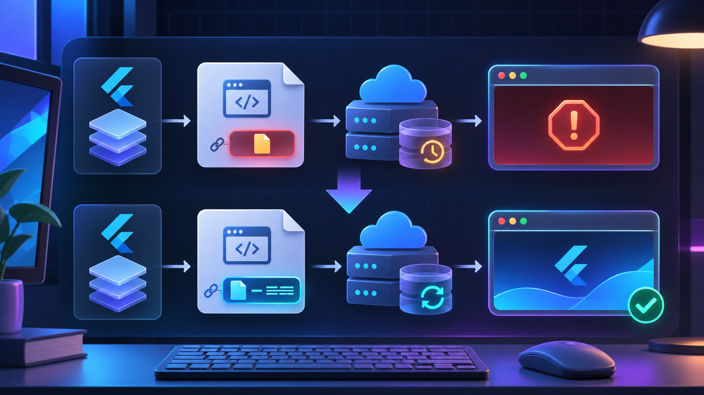

Flutter Web 3.50 이상에서 배포 파일의 캐시 충돌을 줄이려면 `--web-content-hash`를 켜는 선택이 유리하다. 다만 예전 템플릿의 `main.dart.js` 직접 참조나 `loadEntrypoint()`가 남아 있으면 빌드가 실패한다. 기존 `web/index.html`을 오래 유지한 프로젝트에 해당하며, 기본 템플릿을 한 번도 수정하지 않은 새 프로젝트라면 이 마이그레이션부터 할 필요는 없다.

## 오류가 나는 기준

공식 Flutter 문서에서 `--web-content-hash`는 Flutter 3.50 이상 기능이다. 이 옵션은 엔트리포인트와 `assets/**` 파일 이름에 콘텐츠 해시를 넣고, 실제 파일 이름을 `flutter_bootstrap.js`의 빌드 설정에 주입한다. 따라서 아래처럼 고정된 파일을 직접 부르면 새 파일 이름을 알 수 없다.

| 오래된 구성 | 빌드 시 문제 | 바꿀 방향 |
|---|---|---|
| `main.dart.js` 직접 `<script>` 로드 | 해시 파일과 연결되지 않음 | `flutter_bootstrap.js` 사용 |
| `loadEntrypoint()` 호출 | deprecated API 검사에서 중단 | `_flutter.loader.load()` 사용 |
| `{{flutter_build_config}}` 없음 | 해시된 JS/WASM 경로 주입 불가 | bootstrap 설정 토큰 추가 |
| deferred import 사용 | 현재 content hash와 조합 불가 | deferred를 제거하거나 옵션 해제 |

오류 문구가 `Cannot build with "--web-content-hash" because ... contains main.dart.js`라면 Dart 코드나 WASM 자체보다 웹 진입 파일이 1차 원인이다. `flutter clean`만 반복해도 이 문자열은 사라지지 않는다.

## 템플릿을 현재 로더 형태로 맞춘다

커스텀 로딩 화면이 필요해도 Flutter가 해시된 엔트리포인트를 결정하도록 토큰을 남겨야 한다. `web/flutter_bootstrap.js`를 직접 관리하는 프로젝트라면 최소 구성을 아래처럼 둔다.

```js
{{flutter_js}}
{{flutter_build_config}}

_flutter.loader.load();
```

`web/index.html`에서는 예전 `main.dart.js` 스크립트 태그와 `loadEntrypoint` 호출을 제거하고 `flutter_bootstrap.js`를 로드한다. 프로젝트가 오래된 템플릿에서 출발했다면 파일을 부분 수정하기보다 다음 명령으로 웹 템플릿 차이를 확인한 뒤, 커스텀 메타 태그와 로딩 UI만 다시 옮기는 편이 안전하다.

```bash
flutter --version
flutter create . --platforms web
rg -n 'main\.dart\.js|loadEntrypoint|flutter_build_config|flutter_bootstrap' web
flutter build web --web-content-hash
```

`flutter create .`는 기존 Dart 소스와 플랫폼 파일을 지우는 명령이 아니지만, 웹 파일에 로컬 수정이 있다면 먼저 커밋하거나 별도 복사본을 만든다. 빌드가 통과한 뒤 `build/web/flutter_bootstrap.js`에서 `main.dart.<8자리 해시>.js`, `main.dart.<8자리 해시>.wasm`처럼 실제 경로가 주입됐는지 확인한다.

## 옵션을 켜도 바로 해결되지 않는 조건

`--web-content-hash`는 모든 배포 문제를 덮는 캐시 무효화 스위치가 아니다. Flutter 공식 문서 기준으로 `index.html`과 `flutter_bootstrap.js`는 `max-age=0, must-revalidate` 또는 `no-cache`로 재검증해야 한다. 반대로 해시가 붙은 엔트리포인트와 `assets/**`는 `public, max-age=31536000, immutable`로 오래 캐시할 수 있다.

Firebase Hosting을 쓴다면 핵심만 다음처럼 나눈다. 실제 프로젝트에 이미 다른 rewrite가 있으면 이 조각을 통째로 덮어쓰지 말고 규칙 순서를 합친다.

```json
{
  "hosting": {
    "public": "build/web",
    "headers": [
      { "source": "**", "headers": [{ "key": "Cache-Control", "value": "max-age=0, must-revalidate" }] },
      { "source": "assets/**", "headers": [{ "key": "Cache-Control", "value": "public, max-age=31536000, immutable" }] },
      { "source": "main.dart.*.+(js|wasm|mjs)", "headers": [{ "key": "Cache-Control", "value": "public, max-age=31536000, immutable" }] }
    ],
    "rewrites": [
      { "source": "!(/assets/**|/canvaskit/**|/icons/**|/main.dart.*)", "destination": "/index.html" }
    ]
  }
}
```

`deferred as`를 쓰는 앱은 현재 이 옵션과 호환되지 않을 수 있다. 이 경우 해시 옵션을 억지로 유지하기보다 deferred import를 제거할 수 있는지, 아니면 기존 캐시 정책으로 배포할지 결정해야 한다.

## 출시 전 체크리스트

- [ ] `flutter --version`이 3.50 이상이다.
- [ ] `web/index.html`과 `web/flutter_bootstrap.js`에 `main.dart.js`, `loadEntrypoint` 직접 참조가 없다.
- [ ] `{{flutter_build_config}}`와 `_flutter.loader.load()`가 유지된다.
- [ ] `flutter build web --web-content-hash`가 성공한다.
- [ ] `index.html`, `flutter_bootstrap.js`는 재검증되고 해시 파일만 장기 캐시된다.
- [ ] SPA rewrite가 누락된 JS/WASM 요청을 `index.html`로 바꾸지 않는다.
- [ ] deferred import 사용 여부를 확인했다.

핵심은 캐시를 전부 끄는 것이 아니라, 변하지 않는 파일은 해시로 오래 보관하고 진입 파일만 매번 새 배포를 확인하게 만드는 것이다. 빌드 오류가 난다면 `main.dart.js`와 `loadEntrypoint` 잔존 여부부터 찾고, 빌드 성공 뒤에는 HTTP 헤더와 rewrite를 별도로 검증해야 한다.

참고 문서: [Flutter Web 빌드·배포](https://docs.flutter.dev/deployment/web), [Flutter Web 초기화와 커스텀 bootstrap](https://docs.flutter.dev/platform-integration/web/initialization), [Flutter Web FAQ의 캐시 설정](https://docs.flutter.dev/platform-integration/web/faq), [Flutter 도구의 content hash 검증 코드](https://github.com/flutter/flutter/blob/master/packages/flutter_tools/lib/src/commands/build_web.dart)
