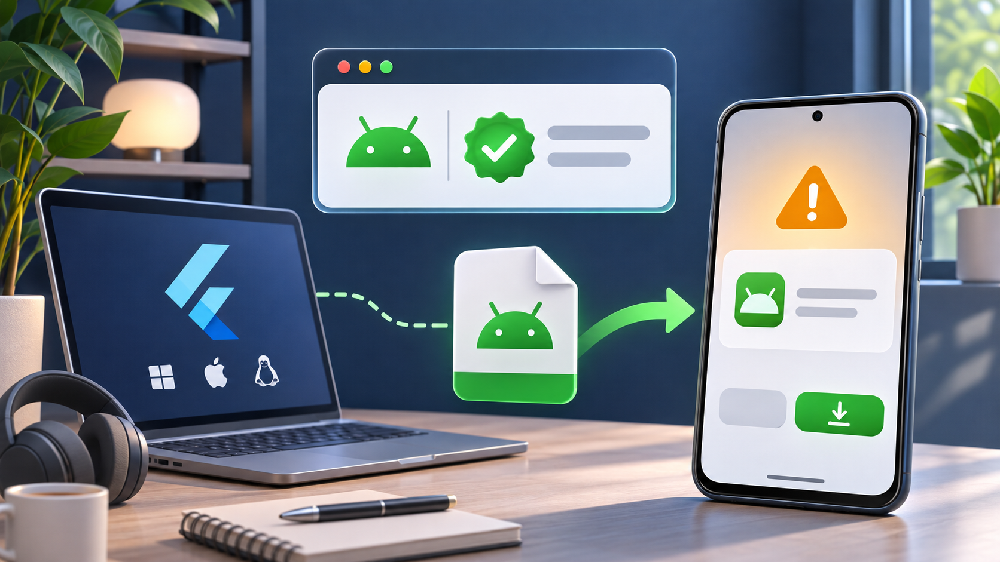

Flutter 앱을 APK로 빌드했는데 특정 국가의 Android 기기에서 설치나 업데이트가 거절된다면, 코드나 서명부터 고칠 문제가 아닐 수 있다. 2026년 9월 30일부터 브라질·인도네시아·싱가포르·태국의 인증 Android 기기에서는 참여 스토어가 개발자 인증 등록 여부를 확인한다. Google Play만 배포하면 자동 등록 경로가 대부분이지만, 사내 APK·고객사 전용 배포·서드파티 스토어라면 Android Developer Console 등록을 출시 조건에 넣어야 한다.

## `flutter build` 성공과 설치 허용은 별개다

Developer Verification은 Flutter 빌드 단계의 오류가 아니다. `flutter build apk --release`가 성공하고 APK 서명도 유효해도, 배포 경로의 개발자와 앱 등록이 확인되지 않으면 설치·업데이트 단계에서 막힐 수 있다.

| 배포 방식 | 2026-11-05 기준 판단 | 우선 확인할 곳 |
| --- | --- | --- |
| Google Play | Play가 앱을 자동 등록하는 경로가 기본이다. 누락 앱은 계정에서 상태를 확인한다. | Play Console 개발자 인증·앱 등록 |
| 사내 웹, 고객사 MDM, 직접 APK | 외부 배포 개발자 등록이 필요할 수 있다. | Android Developer Console |
| 참여 서드파티 스토어 | 스토어와 인증 개발자 등록이 모두 적용 대상인지 확인한다. | 해당 스토어와 Developer Console |
| 한국 기기에서만 테스트 | 초기 적용 국가가 아니어도 2027년 전 세계 확대 계획을 고려한다. | 배포 국가별 운영 계획 |

여기서 “Android 17 문제”라고 단정하면 안 된다. 공식 적용 기준은 Android 7 이상 인증 기기와 특정 국가·참여 스토어 조합이다. 기기 버전보다 실제 설치 국가와 APK가 유통되는 경로가 더 직접적인 조건이다.

## Flutter 프로젝트에서 바꿀 것은 무엇인가

앱이 Google Play에만 올라가고 Play Console에서 개발자 인증 상태가 정상이라면 `AndroidManifest.xml`, `targetSdk`, Flutter 플러그인을 먼저 바꿀 이유가 없다. 반대로 APK를 다운로드 링크로 배포한다면 아래 순서로 운영 경로를 분리한다.

1. APK의 `applicationId`, 버전 코드, 서명 키를 배포 기록과 대조한다.
2. Android Developer Console에서 개발자 계정의 인증 상태와 앱 등록 상태를 확인한다.
3. 개발자 계정에 등록한 앱과 실제 APK의 패키지명이 같은지 확인한다.
4. 인증이 끝난 새 APK를 대상 국가의 인증 기기에서 설치와 업데이트로 각각 테스트한다.

특히 Play App Signing을 쓰는 앱을 외부 APK로도 내보낸다면 서명 키를 혼동하기 쉽다. 이 글의 Developer Verification 등록은 SHA-256 지문을 `assetlinks.json`에 넣는 App Links 설정과 다르다. 링크가 브라우저에서 열리는 문제라면 App Links 검증을, 설치 자체가 제한되는 문제라면 개발자 인증을 먼저 분리해 진단한다.

## 출시 전 체크리스트

- [ ] 배포 국가가 브라질·인도네시아·싱가포르·태국 중 하나인지 확인했다.
- [ ] 대상 기기가 Google 인증 기기인지 확인했다.
- [ ] Google Play 전용인지, 직접 APK·서드파티 스토어인지 배포 경로를 문서화했다.
- [ ] Play Console 또는 Android Developer Console의 개발자 인증 상태를 확인했다.
- [ ] 패키지명·버전 코드·서명 키가 등록 정보와 일치한다.
- [ ] 설치뿐 아니라 기존 버전에서 업데이트도 테스트했다.

무료로 Google Play만 배포하는 앱은 이 문제 때문에 별도 유료 배포 서비스를 살 필요가 없다. 비용과 시간이 생기는 지점은 스토어 밖 APK를 계속 배포해야 할 때다. 그 경우 Flutter 코드를 수정하는 것보다 인증 계정, 패키지명, 서명 산출물의 대응표를 유지하는 편이 재현 가능한 해결책이다.

Android 공식 문서는 2026년 9월 30일부터 초기 적용 국가와 참여 스토어에 보호 기능이 시작되고, 2027년 전 세계 확대를 계획한다고 안내한다. 지역별 적용은 바뀔 수 있으므로 실제 출시 직전에는 [Android Developer Verification 공식 가이드](https://developer.android.com/developer-verification)와 [개발자 등록 안내](https://developer.android.com/developer-verification/guides)를 다시 확인한다.
