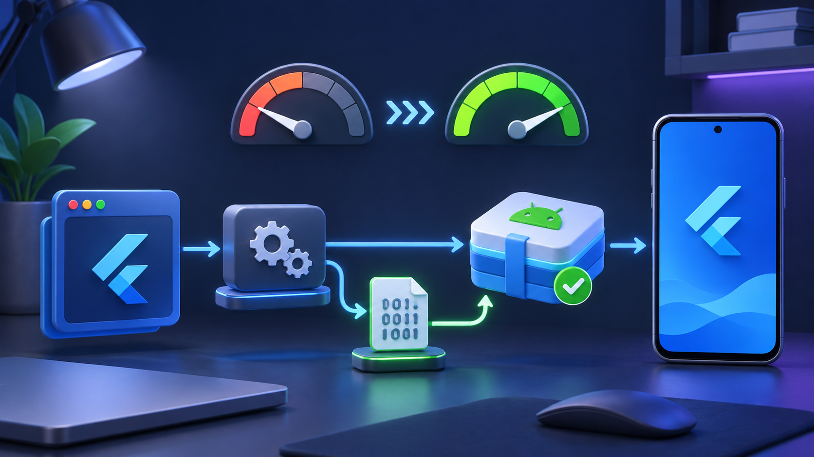

이 그림에서 볼 부분은 Flutter 코드가 바로 빨라지는 것이 아니라, Android가 자주 실행할 경로를 미리 컴파일할 수 있도록 release 번들에 프로파일을 넣는 흐름이다.

Flutter Android 앱의 첫 실행과 초기 화면 전환이 느리다면 `debug` 위젯부터 줄이기보다 Android Baseline Profile을 검토할 가치가 있다. 다만 이 방법은 **Play에 AAB로 출시하는 앱**과 반복되는 시작 경로가 있는 앱에 맞는다. 단순 화면 몇 개뿐이거나 내부 APK만 배포하는 앱은 프로파일 생성 비용이 이득보다 클 수 있다.

## Flutter에서 문제가 보이는 지점

Flutter는 Dart 코드를 AOT로 컴파일하지만, 앱 시작에는 Android 런처, 플러그인 초기화, Flutter 엔진 연결, 첫 화면 진입이 함께 들어간다. 그래서 `flutter run --debug`가 아니라 실제 서명한 `release` 설치본에서 첫 프레임과 첫 이동을 측정해야 한다. Android 공식 문서 기준 Baseline Profile은 `baseline.prof`로 패키징되어 ART가 자주 실행할 코드를 설치 시점에 최적화하도록 돕는다.

| 조건 | 판단 |
|---|---|
| Play Store AAB 출시 | 적용 가치가 높다 |
| 사내 APK·직접 설치만 사용 | 설치 경로에 따라 효과가 늦게 나타날 수 있다 |
| 첫 실행·로그인·홈 진입이 느림 | 해당 경로를 프로파일 시나리오로 만든다 |
| Flutter 화면 자체가 무거움 | Baseline Profile만으로 해결되지 않는다 |

## Android 모듈을 붙이는 최소 구조

Android Studio의 Baseline Profile Generator 템플릿을 쓰는 편이 수동 작성보다 안전하다. Android 공식 문서가 안내하는 최소 전제는 AGP 8.0 이상이며, 생성 모듈은 앱에 포함되지 않는 테스트 모듈이다. 아래는 `android/app`에 플러그인과 생성 모듈 의존성을 연결하는 Kotlin DSL 예시다.

```kotlin
// android/app/build.gradle.kts
plugins {
    id("com.android.application")
    id("androidx.baselineprofile")
}

dependencies {
    implementation("androidx.profileinstaller:profileinstaller:1.4.1")
    baselineProfile(project(":baselineprofile"))
}
```

프로파일 생성 테스트에서는 실제 패키지명을 사용해 앱 시작과 핵심 이동을 기록한다. Flutter의 `integration_test` 전체를 그대로 복사하는 것이 아니라, Android Macrobenchmark가 실행할 짧고 반복 가능한 사용자 여정을 고르는 게 핵심이다.

```kotlin
@Test
fun startup() = baselineProfileRule.collect(
    packageName = "com.example.app",
    profileBlock = {
        uiAutomator { startApp(PACKAGE_NAME) }
        // 로그인 이후 홈처럼 반복되는 핵심 경로를 여기에 추가한다.
    },
)
```

생성 명령은 프로젝트의 Android 디렉터리에서 실행한다.

```bash
cd android
./gradlew :app:generateBaselineProfile
flutter build appbundle --release
```

생성된 `baseline-prof.txt`를 소스에 보관하는 흐름이라면 변경분을 커밋하고, AAB에 실제 바이너리 프로파일이 들어갔는지도 확인한다.

```bash
unzip -l build/app/outputs/bundle/release/app-release.aab \
  | rg 'assets/dexopt/baseline\.prof'
```

## 출시 전에 확인할 것

Baseline Profile은 “빌드 성공”만으로 효과가 증명되지 않는다. Android 공식 문서도 물리 기기에서 생성·벤치마크하고, Play Store 설치와 내부 테스트 트랙을 구분한다. Internal App Sharing에서는 프로파일 효과를 기대하기 어렵고, non-Play 배포는 백그라운드 dexopt 이후에야 반영될 수 있다.

- [ ] Debug가 아닌 서명된 release AAB를 기준으로 측정했다.
- [ ] 앱 시작, 로그인 후 홈, 대표 목록 진입처럼 반복 경로를 1~3개로 좁혔다.
- [ ] 생성 전후를 같은 기기·같은 초기 데이터로 비교했다.
- [ ] AAB에 `assets/dexopt/baseline.prof`가 들어갔다.
- [ ] 프로파일 생성 테스트가 실패해도 임의의 빈 파일을 커밋하지 않았다.
- [ ] 프로파일과 무관한 Flutter 네트워크·DB·이미지 로딩 병목을 별도로 측정했다.

프로파일을 넣었는데도 첫 화면이 느리다면 Flutter 엔진 초기화, 동기식 플러그인 호출, 큰 이미지 디코딩, 첫 API 대기처럼 프로파일이 해결하지 못하는 구간일 수 있다. 반대로 측정 없이 프로파일 생성만 자동화하면 CI 시간이 늘고, 실제 사용하지 않는 경로에 최적화가 집중된다.

짧게 정리하면, Flutter Android의 Baseline Profile은 Dart 성능 옵션이 아니라 Android release 산출물에 실행 경로를 추가하는 운영 설정이다. AGP·Macrobenchmark·Profile Installer 조건을 맞추고, 실제 사용 경로를 생성한 뒤, Play 내부 테스트 트랙의 release 설치본에서 전후 시간을 비교해야 출시 판단에 쓸 수 있다.

참고 문서: [Android Baseline Profiles 개요](https://developer.android.com/topic/performance/baselineprofiles/overview), [Baseline Profile 생성](https://developer.android.com/topic/performance/baselineprofiles/create-baselineprofile), [Flutter 빌드 모드](https://docs.flutter.dev/testing/build-modes)
